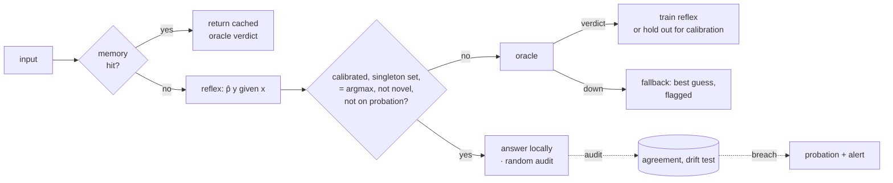

<div align="center">

# Kadı ⚖︎

**A calibrated judge in front of your frontier model.**

Routine decisions are answered locally, with a distribution-free bound on how often they disagree with the oracle.<br>
Everything else is escalated, and every escalation teaches the local judge.

[](https://github.com/zencefilefendi/kadi/actions/workflows/ci.yml)
[](LICENSE)


[Theory](docs/THEORY.md) · [Threat model](docs/THREAT_MODEL.md) · [Türkçe](README.tr.md) · [TypeScript client](clients/typescript)

</div>

---

## Abstract

LLM-based agents and applications make large numbers of small, schema-shaped decisions: route a ticket, flag spam, pick the next tool, approve a change. Sending each one to a frontier model is accurate but slow and expensive. Sending each one to a small model is cheap, but its error rate is unknown. Kadı is a three-tier cascade (exact memory → local reflex → oracle) whose middle tier answers **only when a split-conformal prediction set contains a single label**. Under exchangeability, this bounds the probability that a returned decision disagrees with the oracle by a user-chosen α, marginally or per label (Mondrian).

Doing this in an *online* system needs four mechanisms:

- calibration on a random, **held-out** sample of the stream, never on escalated examples (§5 of the theory notes shows how that shortcut breaks the bound);
- re-scoring of calibration inputs as the model learns;
- Adaptive Conformal Inference for drift;
- a statistically triggered **drift breaker**.

Kadı adds a novelty guard against out-of-distribution and adversarial inputs, shadow-mode deployment, PII redaction, and a hardened HTTP service. It is written in pure standard-library Python with zero dependencies.

## How it works



| Tier | Latency | Cost | Answers when |
|---|---|---|---|
| **Memory** | µs | $0 | the exact input was judged before |
| **Reflex** | ms | $0 | the conformal set is a singleton (and the guards pass) |
| **Oracle** | s | $$ | anything else; its verdict trains the reflex |
| **Fallback** | ms | $0 | the oracle is down and `on_oracle_error = "best_guess"`; flagged, no guarantee |

### The guarantee in one line

$$
\Pr\big(\hat{y} \neq O(x)\big) \;\le\; \Pr\big(O(x) \notin C(x)\big) \;\le\; \alpha
$$

A disagreement requires a local answer, and a local answer requires C(x) = {ŷ}. The full statement, its assumptions, the Mondrian variant, the ACI bound and **what is not guaranteed** are in [docs/THEORY.md](docs/THEORY.md).

### Two policies

| `policy` | Answers locally when | Guarantee | Best for |
|---|---|---|---|
| `"conformal"` (default) | the conformal set is a single label | Pr(disagree) ≤ α **in expectation**; ACI adapts to drift; optional **per-label** bound (`conditional=true`) | rare-but-critical labels, drifting traffic |
| `"ltt"` | max p ≥ λ̂, where λ̂ is certified by **Learn then Test** | **with probability ≥ 1 − δ**, Pr(disagree) ≤ α | many labels; the most local answers at a given α |

## Why not just a confidence threshold?

| | Confidence threshold / vendor router | Kadı |
|---|---|---|
| When it answers locally | Uncalibrated score > hand-tuned cut-off | Conformal set of size 1, consistent with argmax |
| Error statement | Benchmark accuracy on someone else's data | **Disagreement with *your* oracle ≤ α**, per question, optionally per label |
| Under drift | Silent degradation | ACI re-tunes α<sub>t</sub>; drift breaker escalates everything and alerts |
| Evidence | Offline eval | Continuous random audits on live traffic, shown on the dashboard |
| Rollout | Switch over and hope | `replay` on history → `shadow` mode → `live` per question |
| Footprint | Hosted SDK / GPU model | Stdlib Python, SQLite, Apache-2.0, runs offline |

## Quick start

```bash
pip install git+https://github.com/zencefilefendi/kadi
python -m kadi.cli --help        # or simply: kadi --help
```

Live demo: a simulated support desk with an oracle outage and a vocabulary drift, plus the Divan dashboard.

```bash
git clone https://github.com/zencefilefendi/kadi && cd kadi
python examples/demo.py          # then open http://127.0.0.1:8765
python -m unittest discover -s tests
python benchmarks/run.py         # Banking77 + CLINC150 (downloads ~3.5 MB, SHA-256 verified)
```

## Adopting it safely: replay → shadow → live

**1. Replay your history (minutes, no traffic touched).** Export past decisions as JSONL lines of the form `{"text": ..., "label": ...}`, for example past LLM outputs or human labels, and run:

```bash
kadi replay history.jsonl --cost 0.012 --alphas 0.01,0.03,0.05,0.1
```

It prints, for each α, the share of decisions made locally, the error against your labels, steady-state figures and the cost compared with sending everything to the oracle.

**2. Shadow mode (1–2 weeks).** Set `mode = "shadow"`. The oracle keeps answering, and Kadı records what it *would* have said. The dashboard shows the projected local rate and agreement.

**3. Go live, question by question.** Low-risk questions can use α = 3–5%. For high-stakes questions use α ≤ 1% with `conditional = true`, or let Kadı only pre-screen.

> **Choose α above your oracle's noise floor.** An oracle that disagrees with itself ε of the time cannot be matched more closely than about ε. With α ≈ ε, Kadı correctly escalates almost everything.

## Usage

### Python, in-process

```python
from kadi import Kadi, Choice, Binary, AnthropicOracle

kadi = Kadi(
    AnthropicOracle(model="claude-opus-5-5", input_usd_per_mtok=..., output_usd_per_mtok=...),
    db="kadi.db", audit_rate=0.05, on_oracle_error="best_guess",
)

route  = Choice("route_ticket", ["billing", "bug", "feature_request", "account", "spam"],
                "Which team should handle this ticket?", target_error=0.05)
urgent = Binary("is_urgent", "Does this need a human within the hour?",
                target_error=0.02, conditional=True)        # per-label guarantee
intent = Choice("intent", INTENTS, target_error=0.05,
                policy="ltt", delta=0.05)                   # risk ≤ 5% with 95% confidence

d = kadi.decide(route, ticket_text)
d.label, d.tier, d.reason, d.prediction_set, d.flagged     # 'bug', 'reflex', 'confident', ['bug'], False

kadi.teach(route, text, "billing")   # human-reviewed label: trains, never calibrates
```

Oracles: `AnthropicOracle` (forced enum tool), `OpenAICompatibleOracle` (OpenAI, vLLM, Ollama, llama.cpp, LM Studio; JSON with re-ask), and `FunctionOracle` (any callable: rules, a human review queue, an existing model).

### As a service, from any language

```bash
kadi init                                   # writes kadi.toml (questions, oracle, limits)
export KADI_TOKEN=$(python -c "import secrets; print(secrets.token_urlsafe(32))")
export ANTHROPIC_API_KEY=...
kadi serve --config kadi.toml               # or: docker compose up -d
```

```bash
curl -s localhost:8765/api/decide \
  -H "authorization: Bearer $KADI_TOKEN" -H "content-type: application/json" \
  -d '{"question":"route_ticket","text":"I was charged twice this month"}'
```

TypeScript / Next.js:

```ts
import { KadiClient, defineQuestion } from "@kadi/client";

const kadi  = new KadiClient({ baseUrl: process.env.KADI_URL!, token: process.env.KADI_TOKEN });
const route = defineQuestion("route_ticket", ["billing", "bug", "feature_request", "account", "spam"]);
const d = await kadi.decide(route, ticketText);   // d.label: "billing" | "bug" | ...
```

| Route | Purpose |
|---|---|
| `POST /api/decide` | `{question, text, context?}` → decision |
| `POST /api/decide/batch` | `{items: [...]}` (at most 100) → `{results}` |
| `POST /api/teach` | `{question, text, label, context?}` → gold label |
| `GET /api/questions` | registered questions |
| `GET /api/summary`, `/api/timeline`, `/api/feed` | dashboard data (`?window=seconds`) |
| `GET /metrics` | Prometheus metrics |
| `GET /healthz` | liveness (unauthenticated) |

## Divan: the observatory

The built-in dashboard shows:

- money saved compared with sending everything to the oracle;
- the share of decisions made locally;
- **measured** audit agreement;
- local and oracle latency;
- who decided over time, including fallbacks;
- cumulative spend;
- one row per question, called a *court*: mode, why it escalated, target α against live α<sub>t</sub>, realised miscoverage, audit agreement and probation status;
- shadow projections and drift alerts;
- a live docket of decisions with their reasons.

The page itself holds no data. On a protected instance it asks for the token and keeps it in session storage only.

## Evaluation on public benchmarks

`benchmarks/run.py` streams **Banking77** (13,083 queries, 77 intents) and **CLINC150** (22,500 queries, 150 intents) once, in a seeded random order, through a fresh Kadı instance. The gold label plays the oracle, so *error* = disagreement with the oracle = error against ground truth. Dataset files are pinned by SHA-256. Each cell is the mean ± sd over 3 seeds, with audit rate 5%. Full tables: [benchmarks/results/RESULTS-labels.md](benchmarks/results/RESULTS-labels.md).

| | Banking77 local / error | CLINC150 local / error | Error controlled? |
|---|---|---|---|
| threshold τ = 0.5 (naive router) | 85.9% / **18.80%** | 87.2% / **10.41%** | no |
| threshold τ = 0.9 (hand-tuned) | 65.4% / 2.89% | 73.5% / 1.47% | no (τ chosen in hindsight) |
| Kadı conformal, α = 5% | 54.7% / 1.28% | 74.7% / 2.16% | ✅ in expectation |
| **Kadı LTT, α = 2%** | **47.0% / 0.63%** | **69.8% / 1.06%** | ✅ w.p. ≥ 95% |
| **Kadı LTT, α = 5%** | **63.9% / 2.47%** | **79.5% / 3.19%** | ✅ w.p. ≥ 95% |
| **Kadı LTT, α = 10%** | **74.4% / 6.09%** | **85.4% / 6.94%** | ✅ w.p. ≥ 95% |
| Kadı Mondrian (per-label), α = 10% | 3.3% / 0.08% | 10.7% / 0.17% | ✅ per label |

**What the numbers say:**

- **The bound held in every one of the 54 runs** (2 datasets × 3 policies × 3 α × 3 seeds), per seed, not just on average.
- **LTT dominates conformal** at every α, keeping 3.5–9 points more decisions local, because it tests decision risk directly instead of demanding a singleton set.
- **A good fixed threshold is competitive, if you know it in advance.** τ = 0.9 is close to LTT at α = 5%, but the right τ differs per dataset and per model, comes with no guarantee, and τ = 0.5 silently produces 10–19% error. Kadı's contribution is choosing that operating point automatically, with a certificate, and re-certifying as the model and traffic change.
- **Per-label guarantees do not scale to many labels.** Every one of 77 or 150 labels must accumulate its own calibration evidence. Use `conditional = true` for questions with few labels where a rare label is critical.
- Kadı's realised error sits well below α, partly because warm-up decisions are all escalated (zero error) and partly because of the δ margin. With 3 seeds the ± is a rough spread, not a confidence interval.

The reflex here is a hashed n-gram linear model. Stronger reflexes (embeddings) should raise local rates; the calibration layer is model-agnostic.

## Evaluation (synthetic, reproducible)

`examples/demo.py` uses a 2%-noisy simulated oracle at $0.012 per call, an oracle outage at 30–33% of the stream and a vocabulary drift at 50%. It runs 6,000 tickets through 2 questions with α = 5%.

| | Local | Audited agreement | Realised miscoverage | Spend vs. oracle-only |
|---|---|---|---|---|
| `route_ticket`, marginal | 93.4% | 97.3% (216/222) | 6.0% → ACI tightens α<sub>t</sub> to 3.8% | $7.26 vs. $72 |
| `is_urgent`, per label | 42.6% | 95.3% (81/85) | 4.3% | $41.56 vs. $72 |

Per-label guarantees cost coverage. The data are synthetic and lexically easy, so measure yours with `replay` and shadow mode.

## Security and privacy

An independent adversarial review found 11 issues. All are fixed, and each has a regression test. The controls, the threats they address and the residual risks are listed in [docs/THREAT_MODEL.md](docs/THREAT_MODEL.md).

| Area | Controls |
|---|---|
| Access | bearer auth (constant-time), CSRF and DNS-rebinding guards, rate limiting, body and input caps |
| Hardening | strict CSP, non-root read-only container |
| Privacy | KVKK/GDPR-oriented redaction of TCKN, IBAN, cards, phones, e-mail and keys, both in storage and optionally toward the oracle; keyed HMAC input hashes; retention pruning |
| Integrity | schema-locked outputs, prompt-injection delimiting, novelty guard, drift breaker |
| Auditability | **tamper-evident ledger**: every decision is HMAC-chained to the previous one; `kadi verify` pinpoints edited, deleted or inserted rows; `kadi anchor` exports the head for external safekeeping |

## Repository layout

```
kadi/engine.py      cascade, sampling, audits, shadow mode, drift breaker, fallback, persistence
kadi/conformal.py   held-out, re-scored calibration: adaptive conformal (marginal + Mondrian), Learn then Test
kadi/learner.py     online softmax regression (AdaGrad, sparse) + novelty score
kadi/features.py    deterministic, bounded hashing featurizer (word + char n-grams)
kadi/redact.py      PII / secret redaction with checksum validation
kadi/oracles.py     Anthropic / OpenAI-compatible / function oracles, injection-delimited prompts
kadi/server.py      hardened HTTP API, Divan dashboard, Prometheus
kadi/config.py      kadi.toml loader (secrets only via environment variables)
kadi/cli.py         init · serve · replay · dashboard · stats · verify · anchor · prune
kadi/store.py       SQLite ledger (WAL) with schema migrations
clients/typescript  typed client with retries and backoff
benchmarks/         Banking77 + CLINC150 benchmark (SHA-256-pinned data, baselines, real-oracle mode)
docs/               theory, threat model
```

## Roadmap

- Pluggable reflex models: multilingual sentence embeddings (ONNX), k-NN, small fine-tuned LMs
- Postgres ledger and shared state for multi-instance deployments
- Multi-oracle juries: escalate to a second model when oracles disagree
- Budget-aware α (spend caps per question per day)
- OpenTelemetry traces

## Citing

If Kadı is useful in your research, please cite it using [CITATION.cff](CITATION.cff) (GitHub's "Cite this repository" button).

## License

[Apache-2.0](LICENSE). Contributions are welcome; see [CONTRIBUTING.md](CONTRIBUTING.md).
