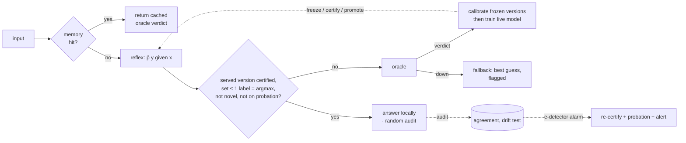

<div align="center">

# Kadı ⚖︎

**A calibrated judge in front of your frontier model.**

Routine decisions are answered locally, with a distribution-free bound on how often they disagree with the oracle.<br>
Everything else is escalated, and every escalation teaches the local judge.

[](https://github.com/zencefilefendi/kadi/actions/workflows/ci.yml)
[](LICENSE)


[Roadmap](ROADMAP.md) · [Engineering report](docs/ENGINEERING.md) · [Theory](docs/THEORY.md) · [Threat model](docs/THREAT_MODEL.md) · [MCP server](docs/MCP.md) · [Türkçe](README.tr.md) · [TypeScript client](clients/typescript)

</div>

---

## Abstract

LLM-based agents and applications make large numbers of small, schema-shaped decisions: route a ticket, flag spam, pick the next tool, approve a change. Sending each one to a frontier model is accurate but slow and expensive. Sending each one to a small model is cheap, but its error rate is unknown.

Kadı is a three-tier cascade: exact memory → local reflex → oracle. The middle tier answers **only when a statistical certificate allows it**: either a split-conformal prediction set with at most one label, or a Learn-then-Test threshold. Under exchangeability, this bounds the probability that a returned decision disagrees with the oracle by a user-chosen α. The bound can be marginal or per label (Mondrian). With Learn then Test it holds **with probability ≥ 1 − δ, uniformly over time**.

Doing this in an *online* system takes four mechanisms (v0.6):

- **Frozen model versions.** A live model learns from every oracle label, but only frozen snapshots answer, and each is certified on calibration samples drawn *after* its freeze. So the scored model is genuinely independent of its calibration data, with no re-scoring and no leakage.
- **Random calibration samples.** The sampling coin never depends on the input. Calibrating on escalated examples is never done; §5 of the theory notes shows how that shortcut breaks the bound.
- **Anytime-valid certification.** Betting e-processes with Ville's inequality, and an error budget δ shared across versions, so every certificate ever issued holds at every point in time.
- **An e-detector on the deployed risk.** It has a bounded false-alarm rate (ARL), and on an alarm the served version is re-certified.

Kadı adds a novelty guard against out-of-distribution and adversarial inputs, shadow-mode deployment, PII redaction, a tamper-evident ledger and a hardened HTTP/MCP service. It is written in pure standard-library Python with zero dependencies.

## How it works



| Tier | Latency | Cost | Answers when |
|---|---|---|---|
| **Memory** | µs | $0 | the exact input was judged before |
| **Reflex** | ms | $0 | the served frozen version's certificate allows it (and the guards pass) |
| **Oracle** | s | $$ | anything else; its verdict calibrates frozen versions and trains the live model |
| **Fallback** | ms | $0 | the oracle is down and `on_oracle_error = "best_guess"`; flagged, no guarantee |

### The guarantee in one line

$$
\Pr\big(\hat{y} \neq O(x)\big) \;\le\; \Pr\big(O(x) \notin C(x)\big) \;\le\; \alpha
$$

A disagreement requires a local answer, and a local answer requires |C(x)| ≤ 1 (an empty set answers the argmax, which is already counted as a miscoverage). The full statement, its assumptions, the Mondrian variant, the ACI bound and **what is not guaranteed** are in [docs/THEORY.md](docs/THEORY.md).

### Two policies

| `policy` | Answers locally when | Guarantee | Best for |
|---|---|---|---|
| `"conformal"` (default) | the conformal set has at most one label | Pr(disagree) ≤ α **in expectation**; ACI adapts to drift; optional **per-label** bound (`conditional=true`) | the most local answers at a given α; rare-but-critical labels |
| `"ltt"` | max p ≥ λ̂, where λ̂ is certified by **anytime-valid Learn then Test** | **with probability ≥ 1 − δ, at every point in time**, Pr(disagree) ≤ α | when you need a high-probability, time-uniform guarantee (audits, regulated use) |

## Why not just a confidence threshold?

| | Confidence threshold / vendor router | Kadı |
|---|---|---|
| When it answers locally | Uncalibrated score > hand-tuned cut-off | A frozen model version's certificate allows it (conformal set ≤ 1 label, or LTT threshold) |
| Error statement | Benchmark accuracy on someone else's data | **Disagreement with *your* oracle ≤ α**, per question, optionally per label |
| Under drift | Silent degradation | ACI re-tunes α<sub>t</sub>; an e-detector with bounded false-alarm rate re-certifies, escalates and alerts |
| Evidence | Offline eval | Continuous random audits on live traffic, shown on the dashboard |
| Rollout | Switch over and hope | `replay` on history → `shadow` mode → `live` per question |
| Footprint | Hosted SDK / GPU model | Stdlib Python, SQLite, Apache-2.0, runs offline |

## Quick start

```bash
pip install git+https://github.com/zencefilefendi/kadi                       # core: zero dependencies
pip install "kadi-cascade[embed] @ git+https://github.com/zencefilefendi/kadi"       # + semantic reflex (fastembed/ONNX)
kadi --help
```

Live demo: a simulated support desk with an oracle outage and a vocabulary drift, plus the Divan dashboard.

```bash
git clone https://github.com/zencefilefendi/kadi && cd kadi
python examples/demo.py          # then open http://127.0.0.1:8765
python -m unittest discover -s tests
python benchmarks/run.py         # Banking77 + CLINC150 (downloads ~3.5 MB, SHA-256 verified)
```

## Adopting it safely: replay → shadow → live

**1. Replay your history (minutes, no traffic touched).** Export past decisions as JSONL lines of the form `{"text": ..., "label": ...}`, for example past LLM outputs or human labels, and run:

```bash
kadi replay history.jsonl --cost 0.012 --alphas 0.01,0.03,0.05,0.1
```

It prints, for each α, the share of decisions made locally, the error against your labels, steady-state figures and the cost compared with sending everything to the oracle.

**2. Shadow mode (1–2 weeks).** Set `mode = "shadow"`. The oracle keeps answering, and Kadı records what it *would* have said. The dashboard shows the projected local rate and agreement.

**3. Go live, question by question.** Low-risk questions can use α = 3–5%. For high-stakes questions use α ≤ 1% with `conditional = true`, or let Kadı only pre-screen.

> **Choose α above your oracle's noise floor.** An oracle that disagrees with itself ε of the time cannot be matched more closely than about ε. With α ≈ ε, Kadı correctly escalates almost everything.

## Usage

### Python, in-process

```python
from kadi import Kadi, Choice, Binary, AnthropicOracle

kadi = Kadi(
    AnthropicOracle(model="claude-opus-5-5", input_usd_per_mtok=..., output_usd_per_mtok=...),
    db="kadi.db", audit_rate=0.05, on_oracle_error="best_guess",
)

route  = Choice("route_ticket", ["billing", "bug", "feature_request", "account", "spam"],
                "Which team should handle this ticket?", target_error=0.05)
urgent = Binary("is_urgent", "Does this need a human within the hour?",
                target_error=0.02, conditional=True)        # per-label guarantee
intent = Choice("intent", INTENTS, target_error=0.05,
                policy="ltt", delta=0.05)                   # risk ≤ 5% with 95% confidence

d = kadi.decide(route, ticket_text)
d.label, d.tier, d.reason, d.prediction_set, d.flagged     # 'bug', 'reflex', 'confident', ['bug'], False

kadi.teach(route, text, "billing")   # human-reviewed label: trains, never calibrates
```

Semantic reflex (optional, `pip install "kadi-cascade[embed] @ git+https://github.com/zencefilefendi/kadi"`):

```python
from kadi.embed import FastEmbedder, HybridFeaturizer, KNNHybridReflex, MULTILINGUAL
kadi = Kadi(oracle, featurizer=HybridFeaturizer(FastEmbedder(MULTILINGUAL)), reflex=KNNHybridReflex())
```

In `kadi.toml`, set `reflex = "embed"` (and optionally `embed_model`). Models are cached under `~/.cache/kadi-models`.

Oracles: `AnthropicOracle` (forced enum tool), `OpenAICompatibleOracle` (OpenAI, vLLM, Ollama, llama.cpp, LM Studio; JSON with re-ask), and `FunctionOracle` (any callable: rules, a human review queue, an existing model).

### As an MCP tool for agents: no API key

```bash
claude mcp add kadi -- kadi mcp          # Claude Code; see docs/MCP.md for Claude Desktop
```

The calling agent *is* the oracle. `kadi_decide` either returns a label or a ticket; the agent judges ticketed cases itself and reports back with `kadi_resolve`. Kadı learns from those verdicts and, once it can certify the error target, stops asking about routine cases. The guarantee is then relative to the agent's own judgement. Full guide: [docs/MCP.md](docs/MCP.md).

### As a service, from any language

```bash
kadi init                                   # writes kadi.toml (questions, oracle, limits)
export KADI_TOKEN=$(python -c "import secrets; print(secrets.token_urlsafe(32))")
export ANTHROPIC_API_KEY=...
kadi serve --config kadi.toml               # or: docker compose up -d
```

```bash
curl -s localhost:8765/api/decide \
  -H "authorization: Bearer $KADI_TOKEN" -H "content-type: application/json" \
  -d '{"question":"route_ticket","text":"I was charged twice this month"}'
```

TypeScript / Next.js:

```ts
import { KadiClient, defineQuestion } from "@kadi/client";

const kadi  = new KadiClient({ baseUrl: process.env.KADI_URL!, token: process.env.KADI_TOKEN });
const route = defineQuestion("route_ticket", ["billing", "bug", "feature_request", "account", "spam"]);
const d = await kadi.decide(route, ticketText);   // d.label: "billing" | "bug" | ...
```

| Route | Purpose |
|---|---|
| `POST /api/decide` | `{question, text, context?}` → decision |
| `POST /api/decide/batch` | `{items: [...]}` (at most 100) → `{results}` |
| `POST /api/teach` | `{question, text, label, context?}` → gold label |
| `GET /api/questions` | registered questions |
| `GET /api/summary`, `/api/timeline`, `/api/feed` | dashboard data (`?window=seconds`) |
| `GET /metrics` | Prometheus metrics |
| `GET /healthz` | liveness (unauthenticated) |

## Divan: the observatory

The built-in dashboard shows:

- money saved compared with sending everything to the oracle;
- the share of decisions made locally;
- **measured** audit agreement;
- local and oracle latency;
- who decided over time, including fallbacks;
- cumulative spend;
- one row per question, called a *court*: mode, why it escalated, target α against live α<sub>t</sub>, realised miscoverage, audit agreement and probation status;
- shadow projections and drift alerts;
- a live docket of decisions with their reasons.

The page itself holds no data. On a protected instance it asks for the token and keeps it in session storage only.

## Evaluation on public benchmarks

`benchmarks/run.py` streams **Banking77** (13,083 queries, 77 intents) and **CLINC150** (22,500 queries, 150 intents) once, in a seeded random order, through a fresh Kadı instance. The gold label plays the oracle, so *error* = disagreement with the oracle = error against ground truth. Dataset files are pinned by SHA-256. Each cell is the mean over 3 seeds (v0.6 engine). *Calls* = oracle calls per decision, including audits; oracle-only = 1.00. Full tables: [hashed](benchmarks/results/RESULTS-labels.md) · [bge + k-NN](benchmarks/results/RESULTS-labels-bge-knn.md) · [MiniLM + k-NN](benchmarks/results/RESULTS-labels-minilm-knn.md).

**α = 5%, local / error / calls:**

| Reflex · policy | Banking77 | CLINC150 | Guarantee |
|---|---|---|---|
| naive threshold τ = 0.5 | 85.9% / **18.80%** / 0.14 | 87.2% / **10.41%** / 0.13 | none |
| hand-tuned threshold τ = 0.9 | 65.4% / 2.89% / 0.35 | 73.5% / 1.47% / 0.27 | none (τ chosen in hindsight) |
| hashed n-grams · conformal | 46.7% / 1.15% / 0.58 | 64.2% / 1.69% / 0.41 | in expectation |
| hashed n-grams · LTT | 49.1% / 1.66% / 0.56 | 65.2% / 1.72% / 0.40 | w.p. ≥ 95%, at all times |
| MiniLM + k-NN · conformal | 63.8% / 2.46% / 0.42 | 77.4% / 3.27% / 0.28 | in expectation |
| MiniLM + k-NN · LTT | 57.4% / 1.92% / 0.48 | 71.4% / 1.14% / 0.34 | w.p. ≥ 95%, at all times |
| **bge-small + k-NN · conformal** | **70.2% / 2.52% / 0.35** | **84.7% / 3.40% / 0.21** | in expectation |
| **bge-small + k-NN · LTT** | **66.2% / 1.74% / 0.39** | **78.1% / 1.32% / 0.27** | **w.p. ≥ 95%, at all times** |

**bge-small + k-NN across α (local / error):**

| α | Banking77 conformal | Banking77 LTT | CLINC150 conformal | CLINC150 LTT |
|---|---|---|---|---|
| 2% | 46.5% / 0.46% | 42.5% / 0.94% | 68.1% / 0.89% | 63.5% / 0.37% |
| 5% | 70.2% / 2.52% | 66.2% / 1.74% | 84.7% / 3.40% | 78.1% / 1.32% |
| 10% | 85.1% / 6.78% | 81.7% / 3.88% | 91.1% / 7.08% | 87.6% / 4.00% |

**What the numbers say:**

- **The bound held in all 126 runs.** That is 2 datasets × 3 reflexes × 2–3 policies × 3 α × 3 seeds, checked per seed, not just on average.
- **At α = 5% the best configuration removes 65% (Banking77) and 79% (CLINC150) of oracle calls.** That is bge + k-NN with the conformal policy; with the time-uniform LTT certificate the figures are 61% and 73%.
- **The naive confidence router silently makes 10–19% errors.** A hand-tuned threshold can look good, but only in hindsight and without any guarantee. Kadı picks its operating point automatically, with a certificate, and re-certifies as the model and traffic change.
- **The price of strict validity (v0.6 vs v0.5).** v0.5 calibrated a model that kept learning, and its LTT certificate was only pointwise in time. v0.6 removes both caveats. In exchange it answers less often at the same α: a median of 9.3 points less across the 36 comparable configurations (range −1.5 to +19.7; the strict-α LTT cells lose the most), because every model version must earn its certificate on fresh data. A stronger reflex recovers most of this; more is on the [roadmap](ROADMAP.md) (P3).
- **Conformal answered locally more often than LTT in 13 of 18 configurations.** Its guarantee is weaker (in expectation), while LTT pays for a high-probability, time-uniform guarantee shared across versions. Pick by the guarantee you need.
- **Per-label (Mondrian) guarantees don't scale to 77–150 labels.** No label collects enough evidence on its own, so Kadı answers ~0% locally. Use `conditional = true` only for questions with few labels.

## Evaluation (synthetic, reproducible)

`examples/demo.py` uses a 2%-noisy simulated oracle at $0.012 per call, an oracle outage at 30–33% of the stream and a vocabulary drift at 50%. It runs 6,000 tickets through 2 questions with α = 5%.

| | Local | Audited agreement | Decision error (est.) | Realised set miscoverage | Spend vs. oracle-only |
|---|---|---|---|---|---|
| `route_ticket`, marginal | 77.8% | 94.9% (314/331) | 4.0% | 6.3% | $19.96 vs. $72 |
| `is_urgent`, per label | 52.2% | 95.5% (321/336) | 2.3% | 5.5% | $36.73 vs. $72 |

Measured with v0.6. *Decision error* is estimated from audits as local share × audited disagreement, and it stays below α. The realised *set* miscoverage on calibration samples is slightly above α. That is consistent with the conformal guarantee being in expectation: ACI's finite-sample bound is loose on a thinned stream (THEORY §7c), and this run includes an oracle outage (145 flagged fallbacks), a vocabulary drift and a 2%-noisy oracle. Compared with v0.4 (94.3% / 62.6% local), strict validity costs local share here too. The data are synthetic and lexically easy, so measure yours with `replay` and shadow mode.

## Security and privacy

An independent adversarial review found 11 issues. All are fixed, and each has a regression test. The controls, the threats they address and the residual risks are listed in [docs/THREAT_MODEL.md](docs/THREAT_MODEL.md).

| Area | Controls |
|---|---|
| Access | bearer auth (constant-time), CSRF and DNS-rebinding guards, rate limiting, body and input caps |
| Hardening | strict CSP, non-root read-only container |
| Privacy | KVKK/GDPR-oriented redaction of TCKN, IBAN, cards, phones, e-mail and keys, both in storage and optionally toward the oracle; keyed HMAC input hashes; retention pruning |
| Integrity | schema-locked outputs, prompt-injection delimiting, novelty guard, drift e-detector, SHA-256-verified model snapshots |
| Auditability | **tamper-evident ledger**: every decision is HMAC-chained to the previous one; `kadi verify` pinpoints edited, deleted or inserted rows; `kadi anchor` exports the head for external safekeeping |

## Repository layout

```
kadi/engine.py      cascade, frozen versions & promotion, sampling, audits, shadow mode, drift monitor, fallback, checkpoints
kadi/conformal.py   per-version calibrators: adaptive conformal (marginal + Mondrian), anytime-valid LTT, e-detector, δ spending
kadi/snapshot.py    compact binary model snapshots (float32, deduplicated rows)
kadi/learner.py     online softmax regression (AdaGrad, sparse) + novelty score
kadi/features.py    deterministic, bounded hashing featurizer (word + char n-grams)
kadi/embed.py       optional semantic reflex: fastembed embeddings, hybrid features, k-NN (extra: [embed])
kadi/redact.py      PII / secret redaction with checksum validation
kadi/oracles.py     Anthropic / OpenAI-compatible / function oracles, injection-delimited prompts
kadi/server.py      hardened HTTP API, Divan dashboard, Prometheus
kadi/config.py      kadi.toml loader (secrets only via environment variables)
kadi/mcp.py         MCP server on stdio (dual-era: initialize + 2026-07-28), agent-as-oracle
kadi/cli.py         init · serve · mcp · replay · dashboard · stats · verify · anchor · prune
kadi/store.py       SQLite ledger (WAL) with schema migrations
clients/typescript  typed client with retries and backoff
benchmarks/         Banking77 + CLINC150 benchmark (SHA-256-pinned data, baselines, real-oracle mode)
docs/               theory, threat model
```

## Status and known limitations

Kadı v0.6 is feature-complete for single-instance use. What has and has not been validated:

| Area | Status |
|---|---|
| Calibration (conformal, Mondrian, anytime-valid LTT, e-detector) | ✅ unit and simulation tests: time-uniform validity of LTT, ARL of the detector, δ spending; the bound held in 126/126 public-benchmark runs |
| Reflex (n-gram, embeddings + k-NN), frozen versions | ✅ benchmarked on Banking77 and CLINC150; promotions, restarts and tampered snapshots are tested |
| Service, security controls, ledger, MCP | ✅ 101 tests, including two adversarial-review regression suites and an MCP stdio end-to-end test; CI on Python 3.11–3.13 + Docker |
| Statistical fine print | ⚠️ exchangeability is still assumed (the detector is the safeguard under shift); the ACI bound is loose; memory answers are not audited. See [THEORY §7c](docs/THEORY.md) |
| **Real LLM oracle** | ⚠️ `AnthropicOracle` / `OpenAICompatibleOracle` are implemented, but benchmarks used **gold labels** as the oracle. A real-oracle run (`benchmarks/run.py --oracle anthropic`) is the first thing to do with an API key |
| **Turkish data** | ⚠️ the multilingual model supports Turkish, but no Turkish benchmark has been run yet |
| Scale-out | ⚠️ single process; model snapshots are side files next to SQLite; multi-instance deployments need the Postgres backend on the roadmap |
| Production traffic | ⚠️ not yet deployed behind a real application. Use replay → shadow → live |

## Roadmap

- Real-oracle benchmark (Claude) and a Turkish intent benchmark
- Embedding-distance novelty guard (nearest-neighbour OOD score) alongside the n-gram guard
- Postgres ledger and shared state for multi-instance deployments
- Multi-oracle juries: escalate to a second model when oracles disagree
- Budget-aware α (spend caps per question per day); conformal risk control for asymmetric costs
- Streamable-HTTP transport for the MCP server; PyPI release; OpenTelemetry traces

## Citing

If Kadı is useful in your research, please cite it using [CITATION.cff](CITATION.cff) (GitHub's "Cite this repository" button).

## License

[Apache-2.0](LICENSE). Contributions are welcome; see [CONTRIBUTING.md](CONTRIBUTING.md).
