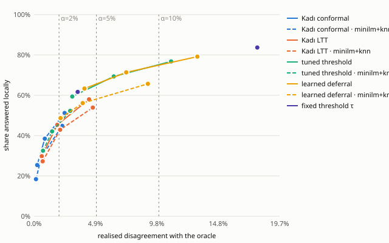
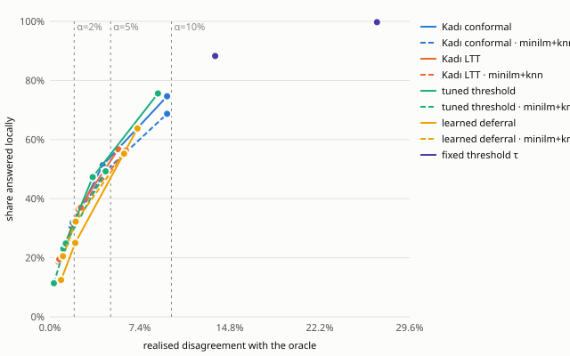
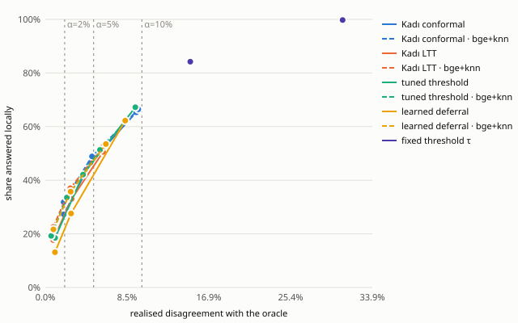
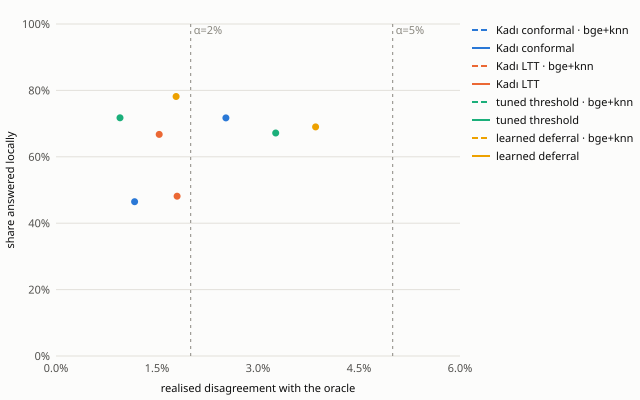
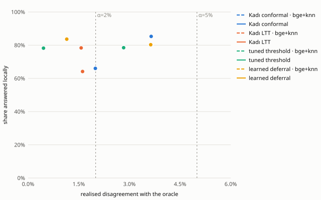

# Kadı — P1 evidence report

Generated by `benchmarks/report.py` from the result files in this folder (`run_all.sh` reproduces them). The oracle is the gold label unless noted.

## 1. Validity

The two policies make different promises, so they are checked differently:

- **LTT** promises, with probability ≥ 1 − δ (δ = 5%), that the risk is ≤ α at every point in time. Check: the share of individual runs whose realised disagreement exceeds α.
- **Conformal** promises E[disagreement] ≤ α (in expectation; ACI steers it *towards* α). Check: whether the mean over seeds stays ≤ α. Individual runs above α are expected.
- **Baselines** promise nothing; the same counts are shown for comparison.

| method | runs above α | CP95 upper bound on per-run violation | cells (α × dataset × reflex) with mean above α |
|---|---|---|---|
| Kadı LTT | 0/220 | 1.4% | 0/22 |
| Kadı conformal | 26/220 | 16.0% | 0/22 |
| tuned threshold (no guarantee) | 34/220 | 20.0% | 3/22 |
| learned deferral (no guarantee) | 57/220 | 31.2% | 4/22 |

## 2. Results by dataset (gold-label oracle)

### massive_tr

| method | reflex | α | local (95% CI) | err (oracle) | err (gold) | calls/dec | violations |
|---|---|---|---|---|---|---|---|
| threshold@0.5 | hashed | — | 83.7% (83.5%–83.8%) | 17.89% | 17.92% | 0.16 | — |
| threshold@0.9 | hashed | — | 61.7% (61.5%–61.8%) | 3.50% | 3.68% | 0.38 | — |
| conformal | hashed | 2% | 25.4% (24.3%–26.2%) | 0.25% | 0.54% | 0.79 | 0/10 |
| conformal | minilm+knn | 2% | 18.4% (17.8%–19.0%) | 0.16% | 0.45% | 0.86 | 0/10 |
| deferral | hashed | 2% | 63.3% (62.4%–64.1%) | 4.05% | 4.20% | 0.37 | 10/10 |
| deferral | minilm+knn | 2% | 48.7% (47.6%–49.7%) | 2.12% | 2.35% | 0.51 | 6/10 |
| ltt | hashed | 2% | 29.8% (28.7%–31.0%) | 0.62% | 0.89% | 0.75 | 0/10 |
| ltt | minilm+knn | 2% | 27.3% (25.8%–28.9%) | 0.69% | 0.97% | 0.77 | 0/10 |
| tuned | hashed | 2% | 59.4% (57.3%–61.1%) | 3.06% | 3.24% | 0.41 | 9/10 |
| tuned | minilm+knn | 2% | 32.5% (30.4%–34.7%) | 0.72% | 0.98% | 0.67 | 0/10 |
| conformal | hashed | 5% | 38.5% (37.3%–39.5%) | 0.86% | 1.13% | 0.66 | 0/10 |
| conformal | minilm+knn | 5% | 29.5% (28.4%–30.5%) | 0.59% | 0.87% | 0.75 | 0/10 |
| deferral | hashed | 5% | 71.3% (70.5%–72.1%) | 7.39% | 7.51% | 0.29 | 10/10 |
| deferral | minilm+knn | 5% | 56.1% (54.9%–57.6%) | 3.90% | 4.10% | 0.44 | 1/10 |
| ltt | hashed | 5% | 45.3% (44.5%–46.1%) | 1.86% | 2.09% | 0.60 | 0/10 |
| ltt | minilm+knn | 5% | 42.9% (41.5%–44.3%) | 2.09% | 2.35% | 0.62 | 0/10 |
| tuned | hashed | 5% | 69.3% (68.1%–70.4%) | 6.39% | 6.52% | 0.31 | 9/10 |
| tuned | minilm+knn | 5% | 42.1% (40.5%–43.8%) | 1.45% | 1.69% | 0.58 | 0/10 |
| conformal | hashed | 10% | 51.2% (49.7%–52.7%) | 2.45% | 2.69% | 0.54 | 0/10 |
| conformal | minilm+knn | 10% | 44.8% (43.7%–46.0%) | 2.26% | 2.51% | 0.60 | 0/10 |
| deferral | hashed | 10% | 79.2% (78.0%–80.3%) | 13.09% | 13.15% | 0.21 | 10/10 |
| deferral | minilm+knn | 10% | 65.7% (63.9%–67.2%) | 9.12% | 9.27% | 0.34 | 4/10 |
| ltt | hashed | 10% | 58.0% (56.1%–59.9%) | 4.41% | 4.61% | 0.47 | 0/10 |
| ltt | minilm+knn | 10% | 53.9% (53.3%–54.4%) | 4.71% | 4.95% | 0.51 | 0/10 |
| tuned | hashed | 10% | 76.8% (75.6%–77.9%) | 10.99% | 11.07% | 0.23 | 7/10 |
| tuned | minilm+knn | 10% | 52.3% (51.0%–53.5%) | 2.90% | 3.13% | 0.48 | 0/10 |

### offenseval_tr

| method | reflex | α | local (95% CI) | err (oracle) | err (gold) | calls/dec | violations |
|---|---|---|---|---|---|---|---|
| threshold@0.5 | hashed | — | 99.7% (99.7%–99.7%) | 26.91% | 26.91% | 0.00 | — |
| threshold@0.9 | hashed | — | 88.3% (86.6%–90.1%) | 13.60% | 13.60% | 0.12 | — |
| conformal | hashed | 2% | 30.5% (28.7%–32.2%) | 1.81% | 1.81% | 0.75 | 2/10 |
| conformal | minilm+knn | 2% | 31.9% (30.9%–33.0%) | 1.87% | 1.87% | 0.73 | 1/10 |
| deferral | hashed | 2% | 12.5% (0.1%–27.4%) | 0.92% | 0.92% | 0.88 | 2/10 |
| deferral | minilm+knn | 2% | 20.5% (13.8%–27.0%) | 1.07% | 1.07% | 0.79 | 1/10 |
| ltt | hashed | 2% | 18.7% (17.8%–19.6%) | 0.69% | 0.69% | 0.86 | 0/10 |
| ltt | minilm+knn | 2% | 19.5% (18.8%–20.2%) | 0.78% | 0.78% | 0.86 | 0/10 |
| tuned | hashed | 2% | 23.0% (18.9%–27.6%) | 1.11% | 1.11% | 0.77 | 0/10 |
| tuned | minilm+knn | 2% | 11.4% (10.5%–12.4%) | 0.33% | 0.33% | 0.89 | 0/10 |
| conformal | hashed | 5% | 51.3% (49.5%–52.9%) | 4.35% | 4.35% | 0.54 | 0/10 |
| conformal | minilm+knn | 5% | 49.4% (48.2%–50.5%) | 4.60% | 4.60% | 0.56 | 1/10 |
| deferral | hashed | 5% | 25.0% (10.0%–42.5%) | 2.09% | 2.09% | 0.75 | 2/10 |
| deferral | minilm+knn | 5% | 32.2% (28.2%–37.0%) | 2.13% | 2.13% | 0.68 | 0/10 |
| ltt | hashed | 5% | 36.4% (35.3%–37.5%) | 2.35% | 2.35% | 0.69 | 0/10 |
| ltt | minilm+knn | 5% | 37.0% (35.6%–38.5%) | 2.56% | 2.56% | 0.68 | 0/10 |
| tuned | hashed | 5% | 47.3% (41.9%–52.6%) | 3.53% | 3.53% | 0.53 | 1/10 |
| tuned | minilm+knn | 5% | 24.8% (23.9%–25.7%) | 1.31% | 1.31% | 0.75 | 0/10 |
| conformal | hashed | 10% | 74.6% (73.4%–75.8%) | 9.64% | 9.64% | 0.31 | 4/10 |
| conformal | minilm+knn | 10% | 68.7% (67.4%–69.8%) | 9.65% | 9.65% | 0.36 | 2/10 |
| deferral | hashed | 10% | 63.8% (48.2%–75.2%) | 7.21% | 7.21% | 0.36 | 2/10 |
| deferral | minilm+knn | 10% | 55.2% (50.7%–60.0%) | 6.10% | 6.10% | 0.45 | 0/10 |
| ltt | hashed | 10% | 56.7% (54.7%–58.4%) | 5.63% | 5.63% | 0.48 | 0/10 |
| ltt | minilm+knn | 10% | 56.3% (55.3%–57.7%) | 6.25% | 6.25% | 0.49 | 0/10 |
| tuned | hashed | 10% | 75.6% (73.8%–77.7%) | 8.89% | 8.89% | 0.24 | 1/10 |
| tuned | minilm+knn | 10% | 49.3% (47.6%–51.0%) | 4.59% | 4.59% | 0.51 | 0/10 |

### hatespeech_en

| method | reflex | α | local (95% CI) | err (oracle) | err (gold) | calls/dec | violations |
|---|---|---|---|---|---|---|---|
| threshold@0.5 | hashed | — | 99.7% (99.7%–99.7%) | 30.78% | 30.78% | 0.00 | — |
| threshold@0.9 | hashed | — | 84.2% (83.9%–84.6%) | 15.01% | 15.01% | 0.16 | — |
| conformal | bge+knn | 2% | 31.8% (30.7%–33.1%) | 1.89% | 1.89% | 0.73 | 4/10 |
| conformal | hashed | 2% | 27.2% (26.0%–28.4%) | 1.91% | 1.91% | 0.78 | 3/10 |
| deferral | bge+knn | 2% | 21.7% (19.1%–24.6%) | 0.84% | 0.84% | 0.78 | 0/10 |
| deferral | hashed | 2% | 13.1% (3.4%–23.6%) | 1.00% | 1.00% | 0.87 | 3/10 |
| ltt | bge+knn | 2% | 22.6% (22.0%–23.2%) | 0.82% | 0.82% | 0.82 | 0/10 |
| ltt | hashed | 2% | 17.7% (16.9%–18.4%) | 0.81% | 0.81% | 0.87 | 0/10 |
| tuned | bge+knn | 2% | 19.2% (18.2%–20.3%) | 0.61% | 0.61% | 0.81 | 0/10 |
| tuned | hashed | 2% | 18.5% (14.9%–22.9%) | 1.02% | 1.02% | 0.81 | 1/10 |
| conformal | bge+knn | 5% | 48.9% (48.0%–49.9%) | 4.83% | 4.83% | 0.56 | 2/10 |
| conformal | hashed | 5% | 46.7% (45.7%–47.7%) | 4.69% | 4.69% | 0.58 | 2/10 |
| deferral | bge+knn | 5% | 35.7% (31.9%–39.7%) | 2.62% | 2.62% | 0.64 | 0/10 |
| deferral | hashed | 5% | 27.6% (14.0%–40.5%) | 2.66% | 2.66% | 0.72 | 2/10 |
| ltt | bge+knn | 5% | 37.0% (36.4%–37.6%) | 2.58% | 2.58% | 0.68 | 0/10 |
| ltt | hashed | 5% | 33.0% (31.8%–34.2%) | 2.72% | 2.72% | 0.72 | 0/10 |
| tuned | bge+knn | 5% | 33.6% (31.2%–36.2%) | 2.23% | 2.23% | 0.66 | 0/10 |
| tuned | hashed | 5% | 42.1% (39.5%–44.9%) | 3.90% | 3.90% | 0.58 | 2/10 |
| conformal | bge+knn | 10% | 66.4% (65.1%–67.8%) | 9.63% | 9.63% | 0.39 | 3/10 |
| conformal | hashed | 10% | 65.3% (64.1%–66.6%) | 9.41% | 9.41% | 0.40 | 2/10 |
| deferral | bge+knn | 10% | 53.5% (49.7%–56.9%) | 6.26% | 6.26% | 0.47 | 0/10 |
| deferral | hashed | 10% | 62.2% (55.0%–68.8%) | 8.27% | 8.27% | 0.38 | 3/10 |
| ltt | bge+knn | 10% | 52.6% (51.6%–53.4%) | 5.99% | 5.99% | 0.53 | 0/10 |
| ltt | hashed | 10% | 50.6% (49.4%–51.8%) | 5.98% | 5.98% | 0.54 | 0/10 |
| tuned | bge+knn | 10% | 51.3% (48.5%–53.7%) | 5.66% | 5.66% | 0.49 | 0/10 |
| tuned | hashed | 10% | 67.2% (64.4%–70.3%) | 9.32% | 9.32% | 0.33 | 4/10 |

### banking77

| method | reflex | α | local (95% CI) | err (oracle) | err (gold) | calls/dec | violations |
|---|---|---|---|---|---|---|---|
| conformal | bge+knn | 5% | 71.7% (69.4%–73.9%) | 2.52% | 2.52% | 0.34 | 0/10 |
| conformal | hashed | 5% | 46.5% (44.8%–48.4%) | 1.17% | 1.17% | 0.59 | 0/10 |
| deferral | bge+knn | 5% | 78.2% (77.1%–79.1%) | 1.78% | 1.78% | 0.22 | 0/10 |
| deferral | hashed | 5% | 69.0% (68.0%–70.2%) | 3.86% | 3.86% | 0.31 | 1/10 |
| ltt | bge+knn | 5% | 66.7% (64.8%–68.5%) | 1.53% | 1.53% | 0.39 | 0/10 |
| ltt | hashed | 5% | 48.1% (46.0%–50.5%) | 1.80% | 1.80% | 0.57 | 0/10 |
| tuned | bge+knn | 5% | 71.7% (70.5%–72.8%) | 0.95% | 0.95% | 0.28 | 0/10 |
| tuned | hashed | 5% | 67.2% (65.7%–68.7%) | 3.26% | 3.26% | 0.33 | 0/10 |

### clinc150

| method | reflex | α | local (95% CI) | err (oracle) | err (gold) | calls/dec | violations |
|---|---|---|---|---|---|---|---|
| conformal | bge+knn | 5% | 85.3% (84.3%–86.3%) | 3.64% | 3.65% | 0.20 | 0/10 |
| conformal | hashed | 5% | 66.0% (64.5%–67.5%) | 1.99% | 2.00% | 0.39 | 0/10 |
| deferral | bge+knn | 5% | 83.6% (82.8%–84.5%) | 1.14% | 1.15% | 0.16 | 0/10 |
| deferral | hashed | 5% | 80.3% (79.3%–81.2%) | 3.63% | 3.64% | 0.20 | 0/10 |
| ltt | bge+knn | 5% | 78.4% (77.4%–79.3%) | 1.57% | 1.58% | 0.27 | 0/10 |
| ltt | hashed | 5% | 64.2% (62.8%–65.8%) | 1.61% | 1.62% | 0.41 | 0/10 |
| tuned | bge+knn | 5% | 78.2% (77.1%–79.2%) | 0.46% | 0.46% | 0.22 | 0/10 |
| tuned | hashed | 5% | 78.5% (77.4%–79.5%) | 2.83% | 2.84% | 0.22 | 0/10 |

## 3. Ablations (α = 5%, hashed reflex, 5 seeds; each row disables one mechanism)

**banking77** (full system for reference: conformal 46.5% local / 1.17% err, ltt 48.1% local / 1.80% err)

| method | reflex | α | local (95% CI) | err (oracle) | err (gold) | calls/dec | violations |
|---|---|---|---|---|---|---|---|
| conformal-calibrate_on_escalated | hashed | 5% | 41.6% (41.2%–41.9%) | 0.69% | 0.69% | 0.58 | 0/5 |
| conformal-fixed_sampling | hashed | 5% | 39.2% (37.2%–41.3%) | 1.15% | 1.15% | 0.63 | 0/5 |
| conformal-no_consistency | hashed | 5% | 46.9% (44.9%–48.8%) | 1.23% | 1.23% | 0.58 | 0/5 |
| conformal-no_freeze | hashed | 5% | 60.3% (58.1%–62.5%) | 1.88% | 1.88% | 0.45 | 0/5 |
| conformal-no_novelty | hashed | 5% | 46.9% (44.9%–48.8%) | 1.23% | 1.23% | 0.58 | 0/5 |
| ltt-calibrate_on_escalated | hashed | 5% | 58.2% (56.2%–61.1%) | 3.17% | 3.17% | 0.42 | 0/5 |
| ltt-fixed_sampling | hashed | 5% | 36.2% (34.0%–38.5%) | 1.41% | 1.41% | 0.66 | 0/5 |
| ltt-no_consistency | hashed | 5% | 49.2% (47.3%–51.0%) | 1.86% | 1.86% | 0.56 | 0/5 |
| ltt-no_freeze | hashed | 5% | 62.2% (61.0%–63.5%) | 1.78% | 1.78% | 0.43 | 0/5 |
| ltt-no_novelty | hashed | 5% | 49.2% (47.3%–51.0%) | 1.86% | 1.86% | 0.56 | 0/5 |
| mondrian-calibrate_on_escalated | hashed | 5% | 0.1% (0.1%–0.1%) | 0.00% | 0.00% | 1.00 | 0/5 |
| mondrian-fixed_sampling | hashed | 5% | 0.1% (0.1%–0.1%) | 0.00% | 0.00% | 1.00 | 0/5 |
| mondrian-no_consistency | hashed | 5% | 0.1% (0.1%–0.1%) | 0.00% | 0.00% | 1.00 | 0/5 |
| mondrian-no_freeze | hashed | 5% | 24.0% (22.8%–25.3%) | 0.12% | 0.12% | 0.80 | 0/5 |
| mondrian-no_novelty | hashed | 5% | 0.1% (0.1%–0.1%) | 0.00% | 0.00% | 1.00 | 0/5 |

**clinc150** (full system for reference: conformal 66.0% local / 1.99% err, ltt 64.2% local / 1.61% err)

| method | reflex | α | local (95% CI) | err (oracle) | err (gold) | calls/dec | violations |
|---|---|---|---|---|---|---|---|
| conformal-calibrate_on_escalated | hashed | 5% | 56.1% (55.8%–56.5%) | 0.55% | 0.56% | 0.44 | 0/5 |
| conformal-fixed_sampling | hashed | 5% | 61.9% (59.0%–63.7%) | 1.89% | 1.90% | 0.41 | 0/5 |
| conformal-no_consistency | hashed | 5% | 66.0% (64.3%–68.0%) | 1.97% | 1.98% | 0.39 | 0/5 |
| conformal-no_freeze | hashed | 5% | 78.4% (77.3%–79.6%) | 3.53% | 3.54% | 0.27 | 0/5 |
| conformal-no_novelty | hashed | 5% | 66.0% (64.3%–68.0%) | 1.97% | 1.98% | 0.39 | 0/5 |
| ltt-calibrate_on_escalated | hashed | 5% | 69.4% (68.8%–70.1%) | 2.35% | 2.37% | 0.31 | 0/5 |
| ltt-fixed_sampling | hashed | 5% | 55.1% (50.5%–59.1%) | 1.45% | 1.46% | 0.48 | 0/5 |
| ltt-no_consistency | hashed | 5% | 65.1% (62.8%–67.7%) | 1.72% | 1.73% | 0.40 | 0/5 |
| ltt-no_freeze | hashed | 5% | 76.2% (75.1%–77.3%) | 1.64% | 1.65% | 0.29 | 0/5 |
| ltt-no_novelty | hashed | 5% | 65.1% (62.8%–67.7%) | 1.72% | 1.73% | 0.40 | 0/5 |
| mondrian-calibrate_on_escalated | hashed | 5% | 0.0% (0.0%–0.0%) | 0.00% | 0.02% | 1.00 | 0/5 |
| mondrian-fixed_sampling | hashed | 5% | 0.0% (0.0%–0.0%) | 0.00% | 0.02% | 1.00 | 0/5 |
| mondrian-no_consistency | hashed | 5% | 0.0% (0.0%–0.0%) | 0.00% | 0.02% | 1.00 | 0/5 |
| mondrian-no_freeze | hashed | 5% | 30.6% (27.8%–33.4%) | 0.06% | 0.08% | 0.73 | 0/5 |
| mondrian-no_novelty | hashed | 5% | 0.0% (0.0%–0.0%) | 0.00% | 0.02% | 1.00 | 0/5 |

**offenseval_tr** (full system for reference: conformal 51.3% local / 4.35% err, ltt 36.4% local / 2.35% err)

| method | reflex | α | local (95% CI) | err (oracle) | err (gold) | calls/dec | violations |
|---|---|---|---|---|---|---|---|
| conformal-calibrate_on_escalated | hashed | 5% | 93.7% (93.3%–94.3%) | 18.35% | 18.35% | 0.06 | 5/5 |
| conformal-fixed_sampling | hashed | 5% | 50.7% (48.4%–53.1%) | 4.56% | 4.56% | 0.52 | 1/5 |
| conformal-no_consistency | hashed | 5% | 51.4% (49.6%–53.0%) | 4.20% | 4.20% | 0.54 | 0/5 |
| conformal-no_freeze | hashed | 5% | 58.2% (57.5%–59.0%) | 4.56% | 4.56% | 0.47 | 0/5 |
| conformal-no_novelty | hashed | 5% | 51.4% (49.6%–53.0%) | 4.20% | 4.20% | 0.54 | 0/5 |
| ltt-calibrate_on_escalated | hashed | 5% | 60.6% (59.7%–61.5%) | 5.99% | 5.99% | 0.39 | 5/5 |
| ltt-fixed_sampling | hashed | 5% | 29.6% (24.2%–33.8%) | 2.54% | 2.54% | 0.72 | 0/5 |
| ltt-no_consistency | hashed | 5% | 35.7% (34.3%–37.1%) | 2.26% | 2.26% | 0.69 | 0/5 |
| ltt-no_freeze | hashed | 5% | 41.3% (40.0%–42.7%) | 2.22% | 2.22% | 0.64 | 0/5 |
| ltt-no_novelty | hashed | 5% | 35.7% (34.3%–37.1%) | 2.26% | 2.26% | 0.69 | 0/5 |
| mondrian-calibrate_on_escalated | hashed | 5% | 75.2% (74.2%–76.0%) | 18.70% | 18.70% | 0.25 | 5/5 |
| mondrian-fixed_sampling | hashed | 5% | 27.6% (25.2%–29.9%) | 4.48% | 4.48% | 0.74 | 0/5 |
| mondrian-no_consistency | hashed | 5% | 30.1% (28.9%–32.2%) | 4.19% | 4.19% | 0.75 | 0/5 |
| mondrian-no_freeze | hashed | 5% | 32.7% (31.0%–34.4%) | 4.10% | 4.10% | 0.72 | 0/5 |
| mondrian-no_novelty | hashed | 5% | 30.0% (28.8%–32.1%) | 4.10% | 4.10% | 0.75 | 0/5 |

## 4. Noisy oracle (three-way metrics)

**banking77** · oracle `noisy:0.03` · oracle vs gold agreement 96.71%

| method | reflex | α | local (95% CI) | err (oracle) | err (gold) | calls/dec | violations |
|---|---|---|---|---|---|---|---|
| tuned | hashed | 2% | 53.0% (49.5%–56.0%) | 2.78% | 2.76% | 0.47 | 5/5 |
| tuned | hashed | 5% | 64.3% (62.9%–65.6%) | 4.76% | 4.06% | 0.36 | 2/5 |
| tuned | hashed | 10% | 72.3% (71.6%–73.1%) | 7.80% | 6.61% | 0.28 | 0/5 |
| conformal | hashed | 2% | 6.1% (5.5%–6.7%) | 0.07% | 3.23% | 0.98 | 0/5 |
| conformal | hashed | 5% | 27.7% (24.3%–31.5%) | 0.97% | 2.89% | 0.77 | 0/5 |
| conformal | hashed | 10% | 50.5% (47.1%–53.8%) | 3.35% | 3.79% | 0.55 | 0/5 |
| ltt | hashed | 2% | 18.3% (16.7%–19.9%) | 0.65% | 3.13% | 0.87 | 0/5 |
| ltt | hashed | 5% | 36.8% (34.5%–39.7%) | 1.89% | 3.25% | 0.68 | 0/5 |
| ltt | hashed | 10% | 53.4% (51.3%–56.7%) | 4.56% | 4.80% | 0.52 | 0/5 |

**offenseval_tr** · oracle `noisy:0.03` · oracle vs gold agreement 97.04%

| method | reflex | α | local (95% CI) | err (oracle) | err (gold) | calls/dec | violations |
|---|---|---|---|---|---|---|---|
| tuned | hashed | 2% | 22.8% (19.2%–27.2%) | 1.83% | 3.43% | 0.77 | 1/5 |
| tuned | hashed | 5% | 49.6% (45.1%–54.9%) | 5.32% | 5.48% | 0.50 | 2/5 |
| tuned | hashed | 10% | 71.6% (68.4%–75.9%) | 9.94% | 9.03% | 0.28 | 1/5 |
| conformal | hashed | 2% | 23.2% (22.1%–24.8%) | 1.69% | 3.60% | 0.82 | 0/5 |
| conformal | hashed | 5% | 43.6% (43.2%–43.8%) | 4.33% | 5.14% | 0.62 | 0/5 |
| conformal | hashed | 10% | 68.1% (66.0%–70.2%) | 9.88% | 9.50% | 0.37 | 1/5 |
| ltt | hashed | 2% | 12.6% (11.5%–13.8%) | 0.63% | 3.15% | 0.92 | 0/5 |
| ltt | hashed | 5% | 28.5% (27.4%–29.8%) | 2.38% | 4.00% | 0.77 | 0/5 |
| ltt | hashed | 10% | 47.6% (47.1%–48.3%) | 5.79% | 6.45% | 0.58 | 0/5 |

